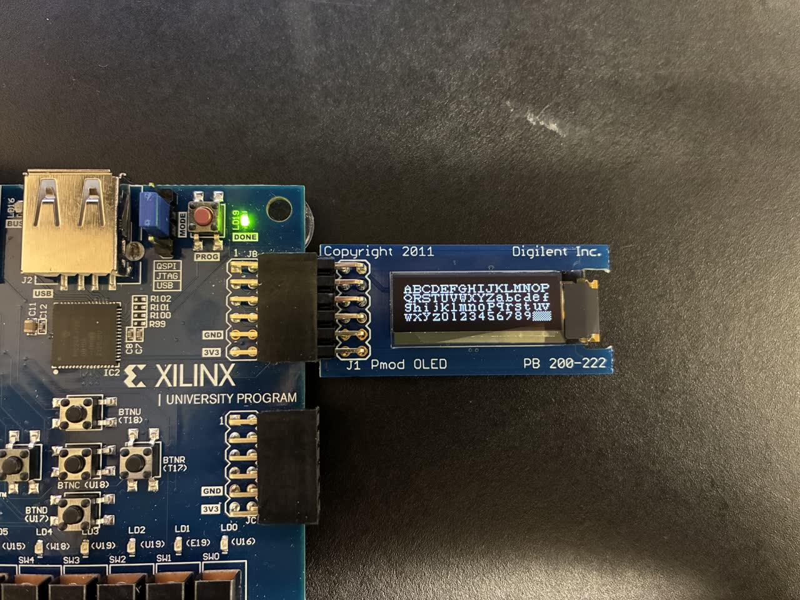
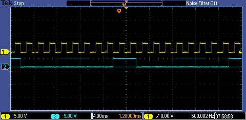

# Basys 3 FPGA Projects (CE 433)

Verilog lab work from CE 433 Embedded Devices at Fort Lewis College, on the
Digilent Basys 3 (Xilinx Artix-7 XC7A35T) in Vivado. Six folders: an
HD44780 LCD driver, traffic-light controllers, a PS/2 keyboard to UART
path, an XADC-to-Arduino serial link checked on an oscilloscope, and two
PicoBlaze soft-processor systems. The XADC link and the PicoBlaze OLED
firmware were run on the board (photo, scope captures and demo clips in
those folders).

&nbsp;

## Projects

| Folder | What it is |
| --- | --- |
| [`lcd-driver/`](lcd-driver/README.md) | 8-bit-interface driver for a 16x2 HD44780-type LCD, with four lab top-levels (switch-selected words, a fixed message, ASCII codes, a 3-bit add/subtract display). |
| [`traffic-light-fsm/`](traffic-light-fsm/README.md) | One six-state, two-road traffic light written five ways, from a counter with gate equations to an FSM with a rush-hour switch. |
| [`usb-keyboard-uart/`](usb-keyboard-uart/README.md) | PS/2 receiver with parity check, scan-code-to-ASCII table and a 9600-baud UART transmitter. |
| [`xadc-spi-bridge/`](xadc-spi-bridge/README.md) | Reads the XADC and shifts the upper byte out to an Arduino on SCK/SS/MOSI lines at 500 Hz; the Arduino reads the bits in software. |
| [`picoblaze-softcore/`](picoblaze-softcore/README.md) | PicoBlaze (KCPSM6) system that reads two numbers from switches, computes a² + b² in assembly and shows it on the seven-segment display and LEDs. |
| [`pmod-oled-system/`](pmod-oled-system/README.md) | PicoBlaze firmware for a pulse (BPM) display on a PmodOLED and an XADC-to-LED readout, plus the a² + b² system with an LCD added. |

## Third-party code

- `kcpsm6.v`, `kcpsm6_design_template.v`, `ROM_form.v` and the generated
  program ROMs (`top.v`, `btn_rom.v`) are Xilinx PicoBlaze files; see their
  headers and [LICENSE](LICENSE).
- `debounce.v`, `seven_segment_mux.v` and `pico_btn.v` are adapted from
  textbook listings (their headers cite Listing 6.2, 4.13 and 17.2; these
  match Pong P. Chu, *FPGA Prototyping by Verilog Examples*).
- The XADC design instantiates `xadc_wiz_0`, a Vivado IP core that is
  generated in Vivado and not included here.

## Building

Create a Vivado project for `xc7a35tcpg236-1`, add the folder's `src/*.v`
and its `.xdc` file, then synthesize, implement and program the board.
For PicoBlaze `.psm` changes, re-assemble with Xilinx's KCPSM6 assembler
to regenerate the ROM file. Pin assignments are summarized in
[`docs/basys3_pinout.md`](docs/basys3_pinout.md). Known gaps are listed in
each folder README.

## License

My code is under the MIT License; the Xilinx PicoBlaze files keep their own
terms. See [LICENSE](LICENSE).
