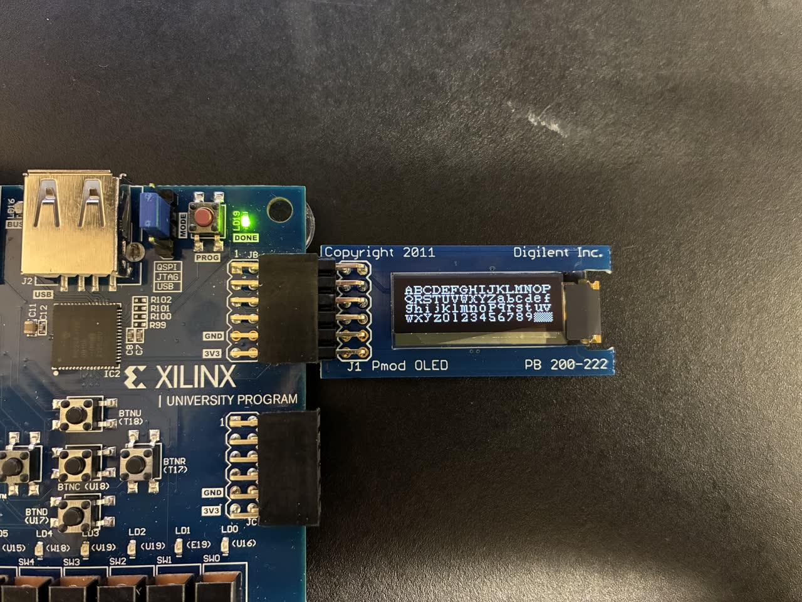

# PicoBlaze with PmodOLED and XADC

CE 433 lab work on the PicoBlaze (KCPSM6) soft processor: firmware that
reads a pulse sensor through the XADC and shows heart rate (BPM) and the
waveform on a Digilent PmodOLED, plus earlier lab steps.

Demo clips (video only):

- [`docs/demo_button_menu.mp4`](docs/demo_button_menu.mp4): pulse sensor on
  a finger, BPM on the OLED, waveform plotted on a PC.
- [`docs/demo_oled_xadc.mp4`](docs/demo_oled_xadc.mp4): 1 Hz sine from a
  function generator into the XADC, shown on the LEDs.

## Files

| File | What it is |
| --- | --- |
| `firmware_button_menu.psm` | Heart-rate firmware (despite the file name): drives the OLED over an SPI port, reads the XADC, detects pulses against a threshold, computes BPM from a millisecond timer port, and draws the waveform. |
| `firmware_xadc_to_leds.psm` | Reads the XADC and shows the 16-bit value on the LEDs (same as `../picoblaze-softcore/src/firmware.psm`). |
| `prog.psm`, `top.v` | Button toggle and press counter; `top.v` is its assembled ROM (module `prog`), not a top-level. |
| `pico_btn.v`, `btn_rom.psm`, `btn_rom.v` | The a² + b² system from `../picoblaze-softcore/` with a 16x2 LCD added, reusing `../lcd-driver/src/lcd_driver.v`. |
| `debounce.v`, `seven_segment_mux.v` | Textbook listings 6.2 and 4.13. |
| `kcpsm6_design_template.v`, `ROM_form.v`, `btn_rom.v`, `top.v` | Xilinx PicoBlaze templates and assembler output. |

## Not included

The Verilog top-level for the OLED build (SPI master, OLED start-up, XADC and
timer ports) and its constraints file are not in this
folder, and neither is `kcpsm6.v` (use the copy in
`../picoblaze-softcore/src/`). The firmware and the clips are the record of
that build.
