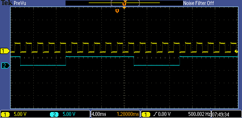
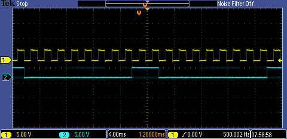

# XADC → SPI Cross-Board Bridge

A two-board mixed-signal system: a Basys 3 FPGA continuously samples an
analog input through its on-chip 12-bit XADC, displays the upper byte
on the LED bar, and simultaneously transmits the value to an Arduino
**over a hand-rolled SPI master interface** — the Arduino then prints
the received byte on its serial console.  The transfer is verified
end-to-end with a Saleae logic-analyser capture of SCK / SS / MOSI.

<p align="center">

&nbsp;

</p>

[`docs/demo.mp4`](docs/demo.mp4) shows the full live system: the
analog input is varied with a potentiometer, the LED bar tracks it on
the FPGA, and the Arduino's serial monitor prints the received byte
in real time.

## Why this is interesting

Most SPI examples lean on a vendor-supplied IP block.  This project
implements the SPI **master state machine in plain Verilog** —
~80 lines of clear, self-contained code that any embedded engineer
can read in two minutes:

```
state 0  IDLE      → wait for `send` strobe
state 1  ASSERT_SS → drive SS low, latch tx byte, prime the shift reg
state 2  SHIFT     → on each falling SCK edge, shift MSB onto MOSI;
                     8 bit-times then return to IDLE with SS de-asserted
```

The interface that matters to the rest of the system:

```verilog
SPI_leader_transmitter spi_tx (
    .clk    (CLK100MHZ),
    .data   (xadc_high_byte),  // ← the byte to send
    .send   (send_strobe),     // ← rising edge starts a transfer
    .sck    (sck),              // ↑↓ generated 1.5625 MHz SPI clock
    .ss     (ss),               // ↓ asserted for the 8 bit-times
    .mosi   (mosi),             // ↗ data shifted MSB-first
    .busy   (spi_busy)          // ↑ high while a transfer is in flight
);
```

The Arduino side runs in **slave mode** with the AVR's hardware SPI
peripheral — see [`arduino/spi_receiver.ino`](arduino/spi_receiver.ino).

## How it's built

```
   ┌────────────────────────────┐                ┌────────────────────────┐
   │          Basys 3            │                │       Arduino UNO      │
   │                             │                │                        │
   │   Analog A0 ─►  xadc_wiz_0  │                │   pinMode(SS, INPUT)   │
   │                  │           │                │   pinMode(SCK, INPUT)  │
   │   12-bit sample  ▼           │                │   pinMode(MOSI, INPUT) │
   │              data_latch ────►│  SPI_leader_   │                        │
   │                              │  transmitter ──┼──► MOSI/SCK/SS         │
   │                              │   (this proj)  │      │                 │
   │   data[15:8] ──► LED bar     │                │      ▼                 │
   │                              │                │  SPI ISR  ─► Serial.print
   └────────────────────────────┘                └────────────────────────┘
```

### Repository layout

```
xadc-spi-bridge/
├── src/
│   ├── xadc_spi_top.v            # top-level: XADC + SPI master + LEDs
│   ├── xadc_spi_top_task2.v      # variant: averaged-sample mode
│   └── spi_leader_transmitter.v  # the SPI master state machine (~80 lines)
├── arduino/
│   └── spi_receiver.ino          # AVR-side SPI slave + Serial.print
├── constraints/
│   └── basys3.xdc                # Basys 3 master XDC (analog + JA pmod)
└── docs/
    ├── demo.mp4                  # full live system demo
    ├── scope_sck_vs_mosi.png     # logic analyser: SCK + MOSI
    └── scope_sck_vs_ss.png       # logic analyser: SCK + SS
```

## Wiring

| FPGA pin (Basys 3) | Function | Arduino pin (UNO) |
| --- | --- | --- |
| JA[1]   | MOSI  | D11 (MOSI) |
| JA[2]   | SCK   | D13 (SCK)  |
| JA[3]   | SS    | D10 (SS)   |
| GND     | GND   | GND        |
| XADC A0 | analog input from potentiometer wiper | — |

The 3.3 V FPGA outputs interface directly to the 5 V Arduino's input
pins — the AVR's logic-1 threshold is ~3.0 V at VCC = 5 V, so no
level shifter is needed *for the FPGA → Arduino direction*.  The
reverse direction would require shifting.

## Validation

The two captures in `docs/` were taken with a Saleae Logic 8 at
12.5 MS/s.

- **`scope_sck_vs_ss.png`** — confirms that SS goes low **before** the
  first SCK rising edge and **after** the eighth falling edge.  No
  hold-time violations against the AVR's 30 ns SCK→SS de-assert
  requirement.
- **`scope_sck_vs_mosi.png`** — confirms MOSI is changed on the
  *falling* edge of SCK (CPHA = 0 with CPOL = 0 means the slave samples
  on the rising edge), so the AVR latches the value mid-bit-time on
  the rising edge.  Eight clean bit transitions are visible per byte.

## What I'd extend it with next

- **Bidirectional duplex** with a slave receiver on the FPGA side, so
  the Arduino can ack each byte and the FPGA can flag missing acks on
  the LEDs.
- **Frame-based protocol** with a sync byte and a CRC-8, so the
  Arduino can recover from cable drops without restarting the FPGA.
- **DMA into a block RAM** — buffer 1024 samples on the FPGA side and
  burst-send 4× the raw bandwidth using back-to-back transactions.
